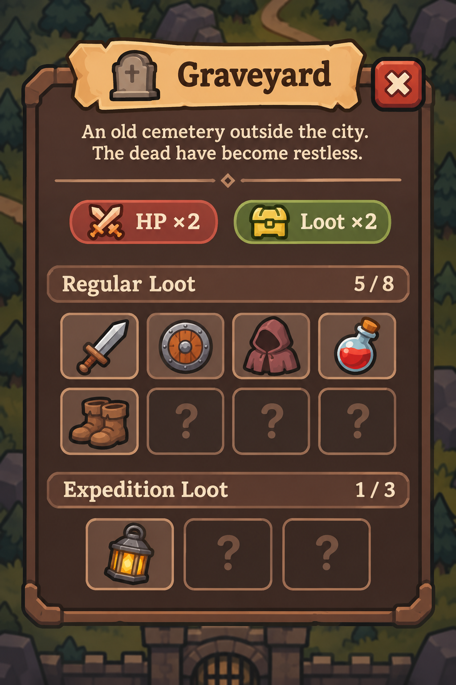

# Информация о данже — рабочая идея

**Статус: Working Concept / Not Scheduled.** Это направление интерфейса и правил, не реализация, не утверждённые значения баланса и не задача для ближайшего спринта.

## Попап на карте

Нажатие на данж открывает **вертикальный попап поверх карты**, рассчитанный на телефон 9:16. Не отдельный экран экспедиции.

- Вверху — **название данжа и закрытие**.
- Под заголовком — **краткое описание на всю ширину**; отдельная большая иллюстрация данжа пока не нужна.
- Далее — **текущие условия/модификаторы**: компактные, читаемые иконки с числовым эффектом, например `HP ×2` или `Loot ×2`. Без длинных карточек с повторяющимися заголовками и описаниями; подробности можно показывать отдельно, если понадобится.
- Основной акцент — две сетки: **Regular Loot** и **Expedition Loot**, с количеством открытых позиций (`5/8`, `1/3` в мокапе — только примеры).
- Визуально: тёплый тёмно-коричневый фон, контрастный текст, простые слоты и минимум вложенных рамок. Иконки добычи — главная цветная часть панели.
- **Кнопки запуска экспедиции в попапе нет.** Она начинается через взаимодействие в магазине с пришедшим приключенцем.

## Добыча

- **Regular Loot:** ориентир — **6–8 базовых видов предметов на данж**. Их могут приносить обычные приключенцы.
- **Expedition Loot:** ориентир — **2–3 дополнительные позиции**, доступные только при собственной экспедиции. Это небольшой целевой набор, а не ещё одна большая таблица.
- Экспедиция разыгрывает **обычный пул плюс дополнительный**. Она может принести только обычные вещи; попадание в Expedition Loot **не гарантируется**.
- Редкость, качество и Exceptional определяются правилами выпадения, а не лицензией. **Exceptional и трейты не образуют отдельные коллекционные позиции**: учитывается базовый предмет.
- Точные шансы дропа **не показываем** в попапе; таблицы, веса и баланс определим позже.

## Коллекция / открытие источников

- До первого обнаружения неизвестный вид предмета показан **одинаковым закрытым слотом с `?`**. Не показываем силуэт, по которому можно заранее угадать тип предмета.
- После первой находки вид предмета раскрывается в отчёте **конкретного данжа**. Продать предмет оптовику или оставить себе — на открытие не влияет: увидеть его достаточно.
- Если один базовый предмет встречается в разных данжах, открытие в одном **не открывает его в другом**. Игрок узнаёт именно источники добычи, а не только существование предмета в мире.
- Regular и Expedition показывают **дополнительные, не продублированные позиции**. Прогресс каждого раздела считается отдельно.
- Новое обнаружение может сопровождаться небольшим `New Discovery` при распаковке мешка; в отчёте на карте после этого появляется соответствующая иконка. Это направление, не реализованный эффект.

## Состояние данжа

- Данж может временно становиться сложнее/легче, богаче/беднее. **Одни и те же условия действуют на обычных приключенцев и на собственные экспедиции.**
- Пример `Enemy HP ×2`: сложнее успешно вернуться, поэтому может уменьшиться поток удачных мешков из данжа; это **не прямой штраф** к добыче тех, кто справился.
- Пример `Loot ×2`: больше добычи при успехе, но это **не автоматический рост** вероятности успешной вылазки.
- Эти изменения могут также влиять на разговоры покупателей и спрос на расходники, если появятся соответствующие механики.
- Условия временные; сами наборы возможной добычи предполагаются относительно устойчивыми. Точное расписание, набор модификаторов и их формулы ещё не решены.

## Не решили / не кодим сейчас

- Конкретные таблицы, веса, правила количества предметов и вероятность эксклюзивного дропа при экспедиции.
- Частоту обновления условий, взаимодействие модификаторов и ограничения их числа.
- Нужны ли подсказки по нажатию на модификатор и дополнительные детали в попапе.
- Анимацию открытия новых предметов, порядок слотов и обработку очень больших будущих пулов.

**Примечание к макету:** Graveyard, `HP ×2`, `Loot ×2`, изображения предметов и числа открытий — примеры, а не баланс или окончательный контент.

**Источники:** макет скопирован из `resources/designs/dungeon_info.png`. `resources/` остаётся свободным складом исходников; документ использует отдельную копию изображения.
