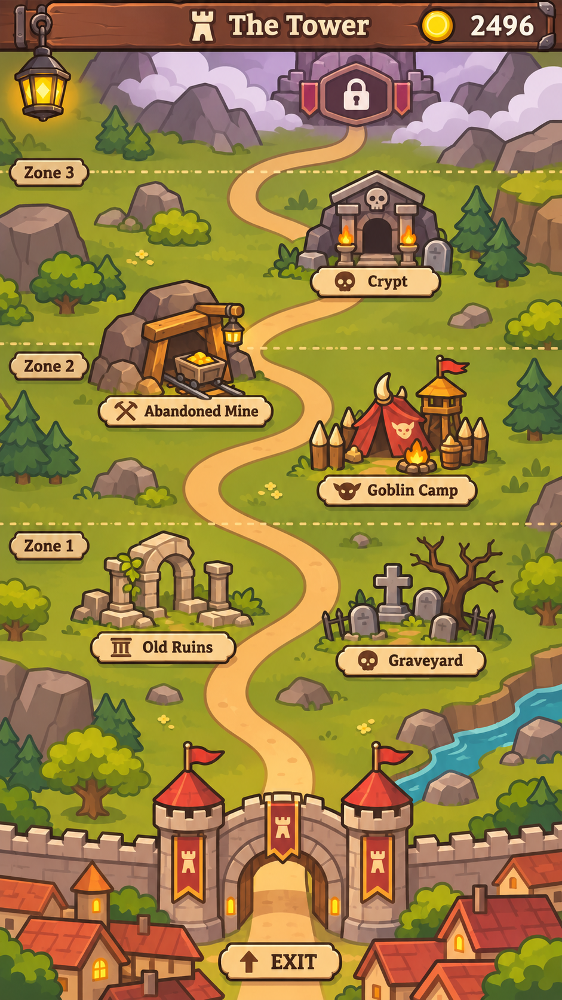

# Карта данжей — рабочая идея

**Статус: Working Concept / Not Scheduled.** Направление обсуждено, но не реализовано и не включено в план ближайшего магазинного цикла. Макет — ориентир для композиции, не финальный UI или список данжей.

## Направление

- **Мобильный портретный экран 9:16.** Карта вертикально прокручивается пальцем; на одном экране видна только часть мира. Не нужно уместить все данжи сразу.
- **Город внизу:** вид чуть сверху на городскую стену и ворота. Дорога выходит за ворота и идёт вверх, в более опасные земли.
- **Извилистая дорога, свободное расположение данжей.** Точки не выстраиваются ровными рядами; небольшие ответвления и расстояния создают ощущение местности, а не списка уровней.
- **Простая 2D-графика в стиле магазина:** чистые формы, читаемые силуэты, минимум декоративных деталей. Данжи и ворота выглядят примерно сверху, а не как отдельные подробные иллюстрации.
- **Прогрессия через местность:** ближе к городу — привычное окружение, дальше — более дикие/опасные ландшафты. Не делить карту цветными полосами, тинтами или заметными пунктирными границами. Технические зоны могут существовать без визуальной разметки.
- Названия и состояние данжей должны читаться на телефоне. Нажатие на точку открывает [информационный попап данжа](dungeon-info.md).

## Прогрессия и лицензии

- Прогрессия привязана **к доступу к зонам/регионам**, а не к качеству, редкости или типу отдельных предметов.
- Рабочее лорное объяснение: расширение лицензии магазина на работу с добычей из более дальних зон. Точный механизм получения лицензии ещё не определён.
- Доступные зоны определяют, **из каких данжей приключенцы могут приносить мешки**. Что именно окажется в мешке (включая возможный Exceptional) — дело таблицы добычи данного данжа, а не отдельной лицензии на предмет.
- Каждый данж — самостоятельный источник добычи с собственными таблицами и условиями. Экспедицию игрок организует **из магазина**, при появлении подходящего приключенца, а не кнопкой на карте.
- Карту используем прежде всего для понимания источников товара, доступных мест и состояния мира; это не экран ручного путешествия игрока.

## Что ещё не определено

- Количество зон и данжей, их названия, маршруты и точное расположение.
- Стоимость/условия расширения лицензии, степень зависимости от репутации и способы показа закрытых мест.
- Состояния точек (`available`, `locked`, `new`), подписи и детали интерактивности.
- Как именно отображать дальние ещё не открытые области карты.

**Примечание к макету:** подписи `Zone 1/2/3`, пунктиры, количество и состав данжей — элементы ранней визуальной пробы, **не утверждённая схема карты**. Планируем попробовать более естественные переходы местности без явных границ.

**Источники:** макет скопирован из `resources/designs/map.png`. Папка `resources/` — свободное хранилище исходных референсов и экспериментов; проверенные для документации изображения копируются сюда, а не переименовываются/удаляются из `resources/`.
